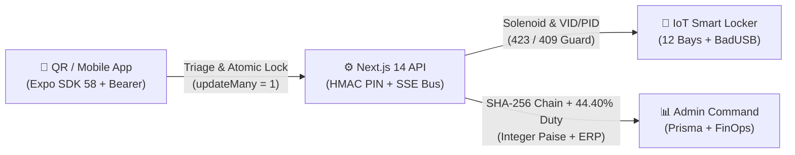
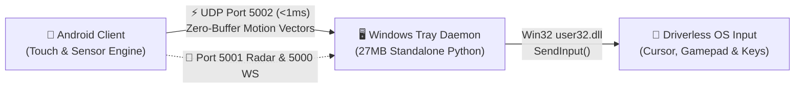

# Shubham Agrawal

  

Indore, India • B.Tech CSE '25 (IES, IPS Academy) • Open to Relocation / Remote

  
  
  
  
  
  

<b>Interactive Dual-Mode Portfolio:</b> <a href="https://shubham-agrawal-portfolio.vercel.app/">shubham-agrawal-portfolio.vercel.app</a> (<a href="https://github.com/AgrShubham/shubham-agrawal-portfolio">Source</a>) — React 19, TypeScript 5.8, custom HTML5 Canvas grid &amp; 6-viewport Puppeteer audit (0px overflow).

<table>
  <tr>
    <td width="33%" align="center">
      <b>🏢 Enterprise Full-Stack &amp; Mobile</b> 
      Next.js 14, Expo / React Native, Prisma &amp; PostgreSQL with atomic concurrency, HMAC security, integer-paise math &amp; real-time SSE.
    </td>
    <td width="33%" align="center">
      <b>⚡ Low-Latency Systems</b> 
      Sub-millisecond UDP streaming (Port 5002) directly into Win32 <code>user32.dll</code> <code>SendInput</code>, bypassing TCP head-of-line blocking.
    </td>
    <td width="33%" align="center">
      <b>🛍️ Production Web &amp; Honors</b> 
      Built <b>Shree Mewa</b> (React 19 + Vite 6 + Tailwind v4) &amp; won <b>2nd Position</b> at Udaan 2024 CSI National Project Exhibition.
    </td>
  </tr>
</table>

---

## 🛠️ Featured Engineering Projects

### 1. [KioskDrop Enterprise](https://kioskdrop-enterprise.vercel.app/) — Smart-Locker ITAM, FinOps & Mobile Platform
> *End-to-end corporate AV hardware triage, 12-bay IoT smart-locker simulator, zero-trust BadUSB defense & Indian Customs FinOps across **Next.js 14** and **React Native / Expo**.*

  
  
  
  
  
  

- **Concurrency & Zero-Trust Security:** Atomic `prisma.lockerCompartment.updateMany` (`count === 1`) verified under a **20-worker parallel race test**; timing-safe HMAC-SHA256 OTP verification (`crypto.timingSafeEqual`), 5-fail lockout (`HTTP 423`), BadUSB foreign VID/PID quarantine (`HTTP 409`), and tamper-evident SHA-256 `CustodyLog` hash chaining.
- **FinOps, Customs Math & Telemetry:** Integer-paise Indian Customs Duty Engine (`44.40%` statutory BCD/SWS/IGST with zero float drift), RBAC Zaggle/Happay PO reconciliation (SAP/Oracle/Zoho adapters), ServiceNow/Zendesk webhook replay, and live SSE streaming (`/api/telemetry/stream`) across Web and Android (`react-native-sse`).
- **Verification & Stack:** **39/39** Vitest backend/API tests + **24/24** Jest/RNTL mobile tests passing • `Next.js 14` • `React Native / Expo SDK 58` • `TypeScript` • `Prisma` • `PostgreSQL / SQLite WAL` • `TanStack Query` • `Zustand` • `Zod` • `Docker`

---

### 2. [Remote Trackpad & Gamepad Pro](https://github.com/AgrShubham/Remote-trackpad-app) — Low-Latency Wireless Peripheral Ecosystem
> *Sub-millisecond UDP mouse/gamepad/keyboard engine bypassing TCP head-of-line blocking for Windows 10/11.*

  
  
  
  
  

<table>
  <tr>
    <td align="center" width="25%">
       
      <b>Precision Trackpad</b> 0.1px deadband &amp; ballistics
    </td>
    <td align="center" width="25%">
       
      <b>Console Gamepad</b> Arc, Xbox &amp; PlayStation layouts
    </td>
    <td align="center" width="25%">
       
      <b>Mechanical Keyboard</b> 3D bevel keycaps &amp; LED states
    </td>
    <td align="center" width="25%">
       
      <b>Hifi Media Deck</b> Touch scrubber &amp; video controls
    </td>
  </tr>
</table>

- **UDP Motion & Kinetic Ballistics:** Bypasses TCP congestion windows via asynchronous UDP datagrams (**Port 5002**) straight into Windows `user32.dll` `SendInput` (`<1ms` execution), shaped by `v_smooth = v_raw * (1.0 + min(2.5, v_raw * 0.6))` and a `0.1px` jitter deadband.
- **Zero-Driver Footprint & Stack:** 27MB standalone tray daemon requiring no kernel drivers or admin privileges • `Python 3.11` • `React Native` • `TypeScript` • `UDP Sockets` • `Win32 API` • `Android SDK`

---

### 3. [Shree Mewa](https://shree-mewa.vercel.app) — Commercial Luxury Boutique & Gifting Platform
> *Production e-commerce platform replacing high-ticket checkout drop-off with a state-driven WhatsApp Concierge pipeline.*

  
  
  
  
  
  

<table>
  <tr>
    <td align="center" width="33%">
       
      <b>Royal Keepsake Chest</b> Teakwood heirloom gifting suite
    </td>
    <td align="center" width="33%">
       
      <b>Imperial Velvet Suite</b> 24K gold foil rigid gift box
    </td>
    <td align="center" width="33%">
       
      <b>Shubh Vivah Hamper</b> Handcrafted bridal platter
    </td>
  </tr>
</table>

- **Concierge Funnel & Offline Lookbook:** Eliminated bespoke order cart abandonment (`₹25,000+` hampers) by serializing pack weights, delivery tiers, and custom notes directly into WhatsApp; built a CSS `@media print` lookbook engine, route-level `React.lazy` splitting, and Schema.org JSON-LD SEO.

---

### 4. Fintech Mobile Ledger & Zero-Install Web Input

<table>
  <tr>
    <td width="50%" valign="top">
      <h4>💳 <a href="https://github.com/AgrShubham/MiniLedger">MiniLedger</a> — Fintech Mobile App &amp; API</h4>
      

        
        
        
      

      <ul>
        <li><b>Financial Integrity:</b> Integer minor-unit storage (<code>amountMinor</code>) + SQL database aggregates eliminating IEEE-754 rounding drift; date-only <code>@db.Date</code> overdue invariant (<code>PENDING &amp;&amp; dueDate &lt; today</code>).</li>
        <li><b>Concurrency &amp; Auth:</b> Atomic <code>updateMany</code> repayment guard returning <code>409 ALREADY_REPAID</code>, HMAC-SHA256 rate-limited OTP + JWT (<code>expo-secure-store</code>), UUID-sanitized Multer receipts, and Jest + Supertest integration suite.</li>
      </ul>
    </td>
    <td width="50%" valign="top">
      <h4>🌐 <a href="https://github.com/AgrShubham/Remote_trackpad_web">Remote Trackpad Web</a> — Browser Input Server</h4>
      

        
        
      

      <table>
        <tr>
          <td width="50%" align="center"></td>
          <td width="50%" align="center"></td>
        </tr>
      </table>
      <ul>
        <li><b>iOS Acoustic Synthesis:</b> Twin-oscillator <b>Web Audio API</b> clicks (<code>1750Hz</code> snap + <code>220Hz</code> clack) bypassing iOS Safari vibration blocks.</li>
        <li><b>60fps rAF Batching:</b> Batches delta vectors via <code>requestAnimationFrame</code>, cutting WebSocket bandwidth by <b>40%</b> over LAN.</li>
      </ul>
    </td>
  </tr>
</table>

---

## 💻 Technical Skills & Stack

<table>
  <tr>
    <td width="21%"><b>Languages</b></td>
    <td>
      
      
      
      
      
      
    </td>
  </tr>
  <tr>
    <td><b>Frontend &amp; Mobile</b></td>
    <td>
      
      
      
      
      
      
      
      
    </td>
  </tr>
  <tr>
    <td><b>Backend &amp; Systems</b></td>
    <td>
      
      
      
      
      
      
      
    </td>
  </tr>
  <tr>
    <td><b>Databases &amp; QA</b></td>
    <td>
      
      
      
      
      
      
    </td>
  </tr>
  <tr>
    <td><b>Cloud &amp; DevOps</b></td>
    <td>
      
      
      
      
      
      
    </td>
  </tr>
</table>

---

## 📊 Developer Velocity & Problem Solving

  <table border="0">
    <tr>
      <td width="46%" align="center">
        
      </td>
      <td width="54%" align="center">
        
      </td>
    </tr>
  </table>

---

## 💼 Experience, Education & Verified Credentials

- **Frontend Web Development Intern — Amnesea (May 2023 – Jul 2023):** Built 15+ modular React & Tailwind CSS components, integrated RESTful APIs with error boundaries, and improved page-load performance by **~35%** (audited via Google Lighthouse).
- **Education & Honor:** **B.Tech in Computer Science & Engineering** (2021 – 2025), IES, IPS Academy, Indore • 🏆 **2nd Position (Runner-up)** — *Udaan 2024 CSI National Project Exhibition*.
- **Verified Certifications:** [AWS Academy Cloud Foundations](https://www.credly.com/go/1mNIxVxM) • [AWS Academy Machine Learning Foundations](https://www.credly.com/go/olUPF91W) • **React.js Essential Training** & **Learning Git and GitHub** (LinkedIn Learning).

  © Shubham Agrawal • <a href="https://shubham-agrawal-portfolio.vercel.app/">Portfolio</a> • <a href="https://linkedin.com/in/shubham-agrawal-dev">LinkedIn</a> • <a href="mailto:shubhamagrawal.code@gmail.com">shubhamagrawal.code@gmail.com</a>

