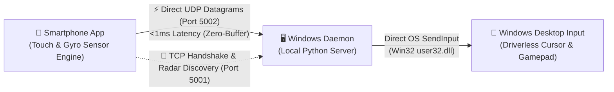

# Shubham Agrawal

  

India • [shubham-agrawal-portfolio.vercel.app](https://shubham-agrawal-portfolio.vercel.app/) • [shubhamagrawal.code@gmail.com](mailto:shubhamagrawal.code@gmail.com)

 

  

<table border="0">
  <tr>
    <td align="center">
      <h3>🌐 Featured Live Portfolio: <a href="https://shubham-agrawal-portfolio.vercel.app/">shubham-agrawal-portfolio.vercel.app</a></h3>
      

        
        
        
        
        
        
      

      

        Engineered a responsive dual-mode digital portfolio with real-time interactive canvas background, glassmorphic UI architecture, and zero layout shift across mobile and desktop devices.
      

      

        <a href="https://shubham-agrawal-portfolio.vercel.app/"><b>👉 Launch Interactive Portfolio Experience ↗</b></a>
      

    </td>
  </tr>
</table>

---

## 🚀 Engineering Highlights

<table>
  <tr>
    <td width="33%" align="center">
      <h3>⚡ Low-Latency Systems</h3>
      
Sub-millisecond UDP datagram streaming over <b>Port 5002</b> directly into Win32 OS APIs (<code>user32.dll</code> via <code>SendInput</code>) with <b>&lt;1ms latency</b>.

    </td>
    <td width="33%" align="center">
      <h3>🛍️ Production Web Apps</h3>
      
Architected <b>Shree Mewa</b> luxury e-commerce with <b>React 19, TypeScript 5.8, Tailwind CSS v4, and Vite 6</b>; eliminated cart drop-off with a WhatsApp concierge funnel.

    </td>
    <td width="33%" align="center">
      <h3>🏆 Academic Excellence</h3>
      
<b>2nd Position (Runner-up)</b> — Udaan 2024 CSI (Computer Society of India) National Project Exhibition. B.Tech Computer Science (2021 – 2025).

    </td>
  </tr>
</table>

---

## 🛠️ Featured Projects & Visual Showcases

### 1. [Remote Trackpad & Gamepad Pro](https://github.com/AgrShubham/Remote-trackpad-app)
> **Turn Smartphone into PC Trackpad, Gamepad & Keyboard**  
> *Low-latency native peripheral ecosystem bypassing TCP head-of-line blocking for Windows 10 & 11 PCs.*

  

  
  
  
  
  
  

<table>
  <tr>
    <td align="center" width="25%">
      
       
      <b>Precision Trackpad</b> 
      0.1px deadband & ballistics
    </td>
    <td align="center" width="25%">
      
       
      <b>Console Gamepad</b> 
      Arc, Xbox & PlayStation layouts
    </td>
    <td align="center" width="25%">
      
       
      <b>Mechanical Keyboard</b> 
      3D bevel keycaps & LED states
    </td>
    <td align="center" width="25%">
      
       
      <b>Hifi Media Deck</b> 
      Touch scrubber & transport controls
    </td>
  </tr>
</table>

- **UDP Motion Pipeline:** Cursor movements bypass TCP congestion control via asynchronous UDP datagrams (`Port 5002`) into Windows `SendInput` with **&lt;1ms execution latency**.
- **Kinetic Ballistics:** Mathematical velocity acceleration (`v_smooth = v_raw * (1.0 + min(2.5, v_raw * 0.6))`) with 0.1px jitter deadband.
- **Driverless Daemon:** 27MB zero-install Windows system tray background daemon; requires zero kernel drivers or admin rights.
- **Stack:** `Python 3.11` • `React Native` • `TypeScript` • `UDP Sockets` • `Win32 API` • `Android SDK`

---

### 2. [Shree Mewa Commercial Platform](https://shree-mewa.vercel.app)
> **Artisanal Dry Fruits & Handcrafted Ceremonial Gifting Boutique**  
> *Production commercial web application solving high-ticket hamper cart abandonment.*

  
  
  
  
  
  

<table>
  <tr>
    <td align="center" width="33%">
      
       
      <b>Royal Keepsake Chest</b> 
      Teakwood heirloom gifting collection
    </td>
    <td align="center" width="33%">
      
       
      <b>Imperial Velvet Suite</b> 
      24K gold foil rigid gift box
    </td>
    <td align="center" width="33%">
      
       
      <b>Shubh Vivah Hamper</b> 
      Handcrafted bridal ceremonial platter
    </td>
  </tr>
</table>

- **WhatsApp Concierge Funnel:** Resolved cart abandonment on bespoke orders (₹25,000+) via an automated state-driven inquiry pipeline serializing configurations directly into WhatsApp.
- **Client-Side Lookbook Engine:** Zero-latency offline PDF catalog generation leveraging dedicated CSS `@media print` stylesheets and Web Share API.
- **Stack:** `React 19` • `TypeScript 5.8` • `Tailwind CSS v4` • `Vite 6` • `Vercel`

---

### 3. [Remote Trackpad Web](https://github.com/AgrShubham/Remote_trackpad_web)
> **Turn Smartphone Browser into PC Mouse (Zero Installation)**  
> *Lightweight Wi-Fi input server with real-time WebSockets and acoustic switch haptics.*

  

  
  
  
  
  

<table>
  <tr>
    <td align="center" width="33%">
      
       
      <b>Browser Trackpad</b> 
      Multi-touch gesture surface
    </td>
    <td align="center" width="33%">
      
       
      <b>Virtual Gamepad</b> 
      Dual thumbsticks & triggers
    </td>
    <td align="center" width="33%">
      
       
      <b>Shortcuts Keyboard</b> 
      Desktop hotkeys & navigation
    </td>
  </tr>
</table>

- **Acoustic Feedback Synthesis:** Synthesized mechanical switch acoustics using the **Web Audio API** (1750Hz tactile snap + 220Hz bottom-out clack), bypassing iOS Safari vibration restrictions.
- **Touch Event Batching:** Batched coordinate deltas with `requestAnimationFrame`, reducing WebSocket network throughput by **40%** while preserving smooth 60fps tracking.
- **Stack:** `Python` • `Flask` • `Socket.IO` • `JavaScript (ES6+)` • `Web Audio API` • `Pynput`

---

## 💻 Technical Skills & Stack

<table>
  <tr>
    <td width="22%"><b>Languages</b></td>
    <td>
      
      
      
      
      
      
    </td>
  </tr>
  <tr>
    <td><b>Frontend & Mobile</b></td>
    <td>
      
      
      
      
      
      
      
    </td>
  </tr>
  <tr>
    <td><b>Backend & Systems</b></td>
    <td>
      
      
      
      
      
      
      
    </td>
  </tr>
  <tr>
    <td><b>Cloud & Tooling</b></td>
    <td>
      
      
      
      
      
      
    </td>
  </tr>
</table>

---

## 📊 Developer Velocity & Activity

  <table border="0">
    <tr>
      <td width="50%" align="center">
        
      </td>
      <td width="50%" align="center">
        
      </td>
    </tr>
    <tr>
      <td colspan="2" align="center">
        
      </td>
    </tr>
  </table>

---

## 💼 Industry Experience & Credentials

- **Frontend Web Development Intern — Amnesea:** Developed 15+ modular React components, integrated RESTful APIs, and optimized page-load latency by **35%** (audited via Google Lighthouse).
- **AWS Academy Certifications:**
  - AWS Academy Graduate — AWS Academy Cloud Foundations
  - AWS Academy Graduate — AWS Academy Cloud Developing
  - AWS Academy Graduate — AWS Academy Machine Learning Foundations
- **Education:** B.Tech in Computer Science & Engineering (2021 – 2025), IES, IPS Academy, Indore.

---

  

    <b>Explore More:</b> <a href="https://shubham-agrawal-portfolio.vercel.app/">shubham-agrawal-portfolio.vercel.app</a> &nbsp;|&nbsp; 
    <a href="https://linkedin.com/in/shubham-agrawal-dev">LinkedIn</a> &nbsp;|&nbsp; 
    <a href="mailto:shubhamagrawal.code@gmail.com">shubhamagrawal.code@gmail.com</a>
  

  © Shubham Agrawal • Designed for engineering impact

