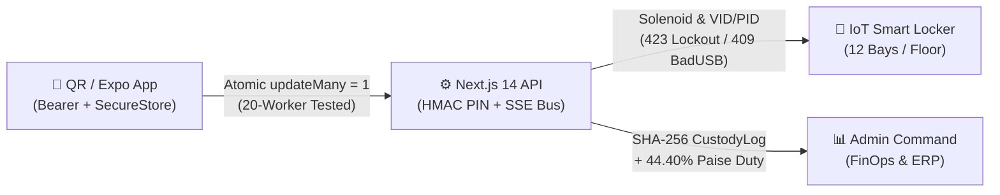

# Shubham Agrawal

  

**Indore, India** • B.Tech CSE '25 (IES, IPS Academy) • Open to Relocation & Remote

  
  
  
  
  

<table>
  <tr>
    <td width="33%" align="center" valign="top">
      <h4>🏢 Enterprise Full-Stack</h4>
      <b>Next.js 14, Expo, PostgreSQL &amp; Prisma</b> Atomic concurrency, HMAC-SHA256 security, integer-paise FinOps &amp; live SSE telemetry.
    </td>
    <td width="33%" align="center" valign="top">
      <h4>⚡ Low-Latency Systems</h4>
      <b>&lt;1ms UDP + Win32 SendInput</b> Driverless wireless input streaming over Port 5002 bypassing TCP head-of-line blocking.
    </td>
    <td width="33%" align="center" valign="top">
      <h4>🛍️ Production Web &amp; Honors</h4>
      <b>React 19, TypeScript 5.8 &amp; CSI Udaan '24</b> Commercial <b>Shree Mewa</b> boutique &amp; <b>2nd Position</b> nationally at CSI Udaan 2024.
    </td>
  </tr>
</table>

---

## 🛠️ Featured Engineering Projects

### 1. [KioskDrop Enterprise](https://kioskdrop-enterprise.vercel.app/) — Smart-Locker ITAM, FinOps & Mobile Platform
> *Autonomous corporate AV hardware triage, 12-bay IoT smart-locker simulator, zero-trust BadUSB defense & Indian Customs FinOps across **Next.js 14** and **React Native / Expo SDK 58**.*

- **Race-Safe Reservations & Live Telemetry:** Conditional `prisma.lockerCompartment.updateMany` (`count === 1`) verified under a **20-worker parallel race test**; live `/api/telemetry/stream` SSE sync across web dashboards and Android (`react-native-sse` + Zod).
- **Zero-Trust Hardware & Audit Security:** Salted HMAC-SHA256 OTP comparison (`crypto.timingSafeEqual`), 5-fail lockout (`HTTP 423`), foreign VID/PID BadUSB quarantine (`HTTP 409`), and immutable SHA-256 hash-chained `CustodyLog`.
- **Indian Customs Duty & FinOps ERP:** Zero-drift integer-paise duty calculator (`44.40%` BCD/SWS/IGST), RBAC Zaggle/Happay card reconciliation (`SAP`, `Oracle`, `Zoho` adapters), ServiceNow/Zendesk webhook replay, and **39/39 Vitest + 24/24 Jest** passing tests.

---

### 2. [Remote Trackpad & Gamepad Pro](https://github.com/AgrShubham/Remote-trackpad-app) — Sub-Millisecond Wireless Peripheral
> *Driverless UDP peripheral ecosystem turning an Android phone into a precision PC trackpad, 3-layout console gamepad & mechanical keyboard.*

<table>
  <tr>
    <td align="center" width="25%">
       
      <b>Precision Trackpad</b> 0.1px deadband &amp; ballistics
    </td>
    <td align="center" width="25%">
       
      <b>Console Gamepad</b> Arc, Xbox &amp; PlayStation layouts
    </td>
    <td align="center" width="25%">
       
      <b>Mechanical Keyboard</b> 3D bevel keycaps &amp; LED states
    </td>
    <td align="center" width="25%">
       
      <b>Hifi Media Deck</b> Touch scrubber &amp; video controls
    </td>
  </tr>
</table>

- **Sub-Millisecond UDP Pipeline:** Streams cursor vectors via **Port 5002** UDP datagrams directly into Windows `user32.dll` `SendInput` (`<1ms` execution), eliminating TCP head-of-line blocking alongside **Port 5001** Wi-Fi radar auto-discovery.
- **Kinetic Ballistics & Driverless Daemon:** Smooth velocity curve `v_smooth = v_raw * (1.0 + min(2.5, v_raw * 0.6))` with `0.1px` deadband filtering, running inside a 27.5MB standalone Windows tray server with zero kernel drivers (`Python 3.11 • React Native • TypeScript • Win32 API`).

---

### 3. [Shree Mewa](https://shree-mewa.vercel.app) — Commercial Boutique & Gifting Platform
> *Production e-commerce platform replacing high-ticket checkout drop-off with a state-driven WhatsApp Concierge pipeline.*

<table>
  <tr>
    <td align="center" width="33%">
       
      <b>Royal Keepsake Chest</b> Teakwood heirloom suite
    </td>
    <td align="center" width="33%">
       
      <b>Imperial Velvet Suite</b> 24K gold foil rigid gift box
    </td>
    <td align="center" width="33%">
       
      <b>Shubh Vivah Hamper</b> Handcrafted bridal platter
    </td>
  </tr>
</table>

- **WhatsApp Concierge & Lookbook Engine:** Eliminated cart abandonment on bespoke orders (`₹25,000+`) by encoding pack weights, delivery tiers, and notes directly into WhatsApp inquiry links; added offline `@media print` PDF lookbook exports, `React.lazy` splitting, and Schema.org JSON-LD SEO.

---

### 4. More Engineering Builds

| Project | Key Engineering Highlights | Stack & Links |
| :--- | :--- | :--- |
| **💳 [MiniLedger](https://github.com/AgrShubham/MiniLedger)** | Fintech loan ledger API & Expo mobile app built with integer minor-unit storage (`amountMinor`) + SQL aggregates, date-only `@db.Date` overdue invariant, atomic `updateMany` returning `409 ALREADY_REPAID`, HMAC-SHA256 OTP + JWT (`SecureStore`), UUID-sanitized Multer receipts & Jest/Supertest suite. | `Node 20` · `Express` · `PostgreSQL 16` · `Prisma` · `Expo` · `TanStack Query` · `Zod` [**Repository ↗**](https://github.com/AgrShubham/MiniLedger) |
| **🌐 [Remote Trackpad Web](https://github.com/AgrShubham/Remote_trackpad_web)** | Zero-install browser trackpad, dual-layout gamepad & TKL keyboard; twin-oscillator **Web Audio API** (`1750Hz` snap + `220Hz` clack) bypassing iOS Safari vibration restriction, plus `requestAnimationFrame` delta batching cutting WebSocket traffic by **40%** at 60fps. | `Python` · `Flask` · `Socket.IO` · `Web Audio API` · `Pynput` [**Repository ↗**](https://github.com/AgrShubham/Remote_trackpad_web) |
| **✨ [Interactive Portfolio](https://shubham-agrawal-portfolio.vercel.app/)** | Dual-mode engineering portfolio featuring a custom 60fps HTML5 Canvas coordinate grid with spring-damped spotlight & click shockwaves, integrated ATS PDF modal, and automated headless Puppeteer verification across 6 viewports (`0px` overflow). | `React 19` · `TypeScript 5.8` · `Tailwind CSS v4` · `Vite 6` [**Live Site ↗**](https://shubham-agrawal-portfolio.vercel.app/) · [**Source ↗**](https://github.com/AgrShubham/shubham-agrawal-portfolio) |

---

## 💻 Technical Skills & Stack

<table>
  <tr>
    <td width="20%"><b>Languages</b></td>
    <td>
      
      
      
      
      
      
    </td>
  </tr>
  <tr>
    <td><b>Frontend &amp; Mobile</b></td>
    <td>
      
      
      
      
      
      
      
    </td>
  </tr>
  <tr>
    <td><b>Backend &amp; Systems</b></td>
    <td>
      
      
      
      
      
      
      
    </td>
  </tr>
  <tr>
    <td><b>Data, Testing &amp; Cloud</b></td>
    <td>
      
      
      
      
      
      
      
    </td>
  </tr>
</table>

---

## 📊 Developer Activity & Problem Solving

  <table border="0">
    <tr>
      <td width="50%" align="center">
        
      </td>
      <td width="50%" align="center">
        
      </td>
    </tr>
  </table>

---

## 💼 Experience, Education & Verified Credentials

- **Frontend Web Development Intern — Amnesea** *(May 2023 – Jul 2023)*: Built 15+ modular React & Tailwind CSS components, integrated RESTful APIs with error boundaries, and reduced initial page-load latency by **~35%** (audited via Google Lighthouse).
- **B.Tech in Computer Science & Engineering** *(2021 – 2025)* — IES, IPS Academy, Indore • 🏆 **2nd Position (Runner-up)**, *Udaan 2024 CSI National Project Exhibition*.
- **Verified Certifications:** [AWS Academy Cloud Foundations](https://www.credly.com/go/1mNIxVxM) • [AWS Academy Machine Learning Foundations](https://www.credly.com/go/olUPF91W) • **React.js Essential Training** & **Learning Git and GitHub** *(LinkedIn Learning)*.

  © Shubham Agrawal • <a href="https://shubham-agrawal-portfolio.vercel.app/">Portfolio</a> • <a href="https://linkedin.com/in/shubham-agrawal-dev">LinkedIn</a> • <a href="mailto:shubhamagrawal.code@gmail.com">shubhamagrawal.code@gmail.com</a>

